> 

> *A Course Project Work Report on*

## “Hospital Appointment & Queue Management System”

> *Submitted in partial fulfillment of the requirements of CCA Phase-1 for*

#### BUILDING ENTERPRISE APPLICATIONS (BCS703B)

> in

#### INFORMATION SCIENCE AND ENGINEERING

> *By*

##### Rohan Balu USN: 1BY23IS177

> **Rishab Paul USN: 1BY23IS175**
>
> **Rahul Sonar USN: 1BY23IS170**
>
> **Rohan Bharat USN: 1BY23IS178**
>
> *Under the guidance of*

#### Poornima G J

> Assistant Professor

#### 2026-2027

# Index

|       |                                          |         |
|-------|------------------------------------------|---------|
| S.No. | Chapters                                 | Page No |
| 1\.   | Abstract                                 | ii      |
| 2\.   | Introduction and motivation              | 1       |
| 3\.   | Problem statement                        | 3       |
| 4\.   | Scope                                    | 4       |
| 5\.   | Software requirements Specifications     | 5       |
| 6\.   | Multi-tier Architectural Specification   | 11      |
| 7\.   | Tech stack selection justification       | 26      |
| 8\.   | Evaluation, Limitations & Risk Treatment | 29      |
| 9\.   | Evaluation Rubrics                       | 30      |
| 10\.  | References                               | 31      |
| 11\.  | Bibliography                             |         |

#  

# ABSTRACT

Outpatient appointment systems can reserve a planned consultation while leaving arrival handling, mixed appointment and walk-in queues, and post-consultation follow-up disconnected. This project proposes a Hospital Appointment & Queue Management System for one hospital with multiple doctors, using requirements analysis, workload modelling, deterministic queue-policy design, and four complementary architectural views. The design environment comprises React and TypeScript interfaces, a NestJS modular monolith, PostgreSQL transactions, durable background jobs, and a Google Cloud reference deployment. The proposed solution separates appointments, visits, queue entries, follow-up tasks, and documents. It combines capacity-controlled booking with a non-preemptive queue policy that applies authorized clinical priority, waiting-time aging, and a two-appointment-to-one-walk-in rotation. Live queue updates and statistical waiting-time estimates support operational visibility. A MediBridge-inspired extension connects prescription OCR, clinically verified instructions, bounded patient assistance, and staff-owned follow-up tasks to capacity-checked return appointments. OCR output remains a draft until authorized review, and automated assistance cannot change treatment or assign clinical priority. For an explicitly synthetic planning workload of 300 visits per day and 200 connected clients, the architectural evaluation targets 100 requests per second for 30 minutes, ordinary API latency at or below 500 milliseconds at the 95th percentile, queue-update freshness within five seconds at the 95th percentile, and no booking or doctor-allocation invariant violations in the defined concurrency tests. These are proposed acceptance targets; implementation, hospital validation, and measured performance results remain Phase 2 work.

# INTRODUCTION & MOTIVATION

**Domain and operational motivation**

The application addresses outpatient consultation scheduling and the queue immediately associated with each doctor and session. Booking determines whether a patient has a reserved opportunity to attend. Queue management determines who can be called when the doctor becomes available. These responsibilities interact, but their records and rules differ. A patient can hold an appointment before arriving, arrive without an appointment, miss a call, or require a later return visit. Reviews of outpatient scheduling discuss the balance between access, patient waiting and provider utilization \[1\]–\[3\].

The proposed problem is workflow fragmentation: reservation information, actual attendance, consultation status, and follow-up responsibility may be handled in separate places. This is a design hypothesis for the college project, not a finding from an observed hospital deployment. No hospital survey, measured waiting-time reduction, or clinical outcome improvement is claimed.

**Relevance to Building Enterprise Applications**

Building Enterprise Applications (BCS703B) concerns the engineering of applications that coordinate business processes, roles, persistent data, and deployment environments. This project applies that perspective through explicit requirements, feasibility estimates, layered architectural specifications, and justified technology choices. Its enterprise character comes from consistent operations across several staff roles, controlled changes to shared records, and recoverable execution \[32\].

**Technology backdrop and design motivation**

A modular monolith is selected because capacity reservation and queue allocation benefit from short, local database transactions. Modules retain distinct responsibilities, while a single backend deployment limits service-to-service failure modes. Google Cloud provides the proposed hosted environment. Containerized local execution supports economical development and demonstration.

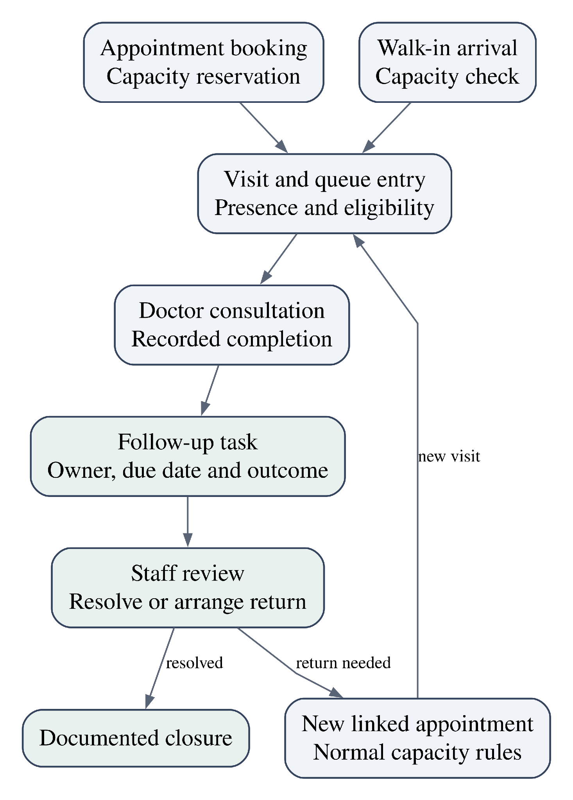

Figure 1. Outpatient workflow with an owned follow-up loop

The distinguishing contribution is the connection between operational queue control and accountable follow-up. Research on ambulatory test-result follow-up motivates explicit responsibility and documented closure \[15\]. The project will use a new implementation and architecture. It does not claim that appointments, OCR, or follow-up assistants are individually novel, or that the combined design is the first of its kind.

# PROBLEM STATEMENT

**Problem Statement**

Design a system that keeps outpatient appointment capacity, actual arrivals, doctor-specific queue decisions, and follow-up responsibility consistent when patients and staff act concurrently. The system must explain why a patient is called next and preserve a traceable route from a completed consultation to a staff disposition or a new return appointment.

**Problem Root Cause**

A reservation, an attended visit, a queue entry, a clinical instruction, and a follow-up task have different lifecycles. Treating them as one token creates ambiguous states and makes cancellation, retries, skipped calls, and later visits difficult to handle correctly. Independent updates without a shared transaction can also oversubscribe capacity or allocate more than one patient to a doctor.

**Operational Impact**

The resulting design risks include conflicting appointment confirmations, inconsistent waiting-room displays, unexplained queue overrides, repeated staff work, and unresolved patient questions without a named owner. These are anticipated failure modes to prevent. Their frequency and financial impact have not been measured in a hospital.

**Target Outcome**

Provide capacity-controlled booking, one outstanding patient allocation per doctor, reproducible queue decisions, and follow-up tasks with ownership and a recorded outcome. Evaluate these properties under the workload and acceptance targets in the SRS. Queue optimization cannot compensate for demand that exceeds available doctor time.

**Objectives**

1\. Separate appointment, visit, queue-entry, document, and follow-up lifecycles with explicit links.

2\. Protect booking, rescheduling, check-in, and call-next operations against concurrent conflicting requests.

3\. Implement and evaluate a deterministic mixed queue policy with authorized priority and aging.

4\. Provide current queue status and qualified waiting-time estimates to authorized users.

5\. Add verified document-based assistance and staff-owned follow-up without delegating clinical decisions to automation.

6\. Define deployment, cost, recovery, and validation plans that a four-member team can implement and defend.

1.  **Scope**

| **Included**               | **Boundary**                                                                                                           |
|----------------------------|------------------------------------------------------------------------------------------------------------------------|
| Appointments               | Doctor/session capacity, booking, cancellation, rescheduling, missed reservations and assisted registration.           |
| Consultation queues        | Check-in, walk-ins, eligibility, call-next, skip/return, pause, consultation start and completion.                     |
| Operational visibility     | Role-specific views, minimal waiting-room displays, live status, ETA and operational summaries.                        |
| MediBridge-inspired add-on | Private documents, OCR drafts, clinical verification, bounded assistance, staff-owned tasks and linked return booking. |
| Administration             | One hospital, doctor/session configuration, staff roles, policy versions and audit records.                            |

Table 1. Approved functional boundary

Out of scope: insurance processing, inpatient admission, billing, pharmacy inventory, laboratory operations, emergency-department triage, autonomous diagnosis or treatment, voice calling, and multi-hospital SaaS. A laboratory document may provide follow-up context; laboratory workflow execution is excluded. Initial notifications are in-app.

**Actors and responsibilities**

| **Actor**              | **Principal responsibility**                                                         |
|------------------------|--------------------------------------------------------------------------------------|
| Patient                | Book and view own appointments, queue state, documents and follow-up interactions.   |
| Reception              | Assisted registration, capacity-checked arrivals and operational queue handling.     |
| Doctor                 | Consultation actions, authorized priority and verification of clinical instructions. |
| Follow-up staff        | Acknowledge assigned work, record disposition and arrange approved returns.          |
| Hospital administrator | Manage staff assignments, session configuration and operational reporting.           |

Table 2. Actor responsibilities

A patient identity can exist without a login, allowing reception-assisted access. Staff permissions are scoped to assigned responsibilities. A return visit consumes normal session capacity and receives a new appointment/visit record linked to the originating follow-up task.

# 5. SOFTWARE REQUIREMENTS SPECIFICATION (SRS)

**5.1 Functional Requirements (FRs):**

The following requirements define the proposed implementation. Acceptance criteria describe intended checks and do not imply that tests have already passed.

**Appointments and access**

<table>
<colgroup>
<col style="width: 19%" />
<col style="width: 38%" />
<col style="width: 41%" />
</colgroup>
<thead>
<tr class="header">
<th><strong>ID and capability</strong></th>
<th><strong>Requirement</strong></th>
<th><strong>Acceptance criterion</strong></th>
</tr>
</thead>
<tbody>
<tr class="odd">
<td>FR-01 
Identity and authorization</td>
<td>The system shall authenticate users and authorize each operation by role, assignment, and resource ownership.</td>
<td>A patient cannot retrieve another patient’s appointment or document. A reception account cannot verify clinical instructions.</td>
</tr>
<tr class="even">
<td>FR-02 
Sessions and capacity</td>
<td>The system shall define doctor/session availability, booked and walk-in capacity, and a versioned queue policy.</td>
<td>The planning configuration supports 10 booked and 5 walk-in places per session. Invalid capacity reductions are rejected.</td>
</tr>
<tr class="odd">
<td>FR-03 
Appointment booking</td>
<td>The system shall reserve available capacity and record the appointment atomically.</td>
<td>Simultaneous requests for the last place produce at most one successful reservation. A retry returns the original outcome.</td>
</tr>
<tr class="even">
<td>FR-04 
Cancellation and rescheduling</td>
<td>The system shall release eligible reservations on cancellation and atomically exchange reservations during rescheduling.</td>
<td>A failed target reservation leaves the original appointment intact. Completed visits never reopen consumed capacity.</td>
</tr>
<tr class="odd">
<td>FR-05 
Arrival and walk-ins</td>
<td>The system shall create a visit and one queue entry after valid check-in or capacity-approved walk-in admission.</td>
<td>Repeated check-in produces no duplicate visit/entry. Late arrival requires the approved capacity and ordering rules.</td>
</tr>
</tbody>
</table>

**5.2 Functional Requirements (FRs) continued**

**Queue and consultation operations**

<table>
<colgroup>
<col style="width: 19%" />
<col style="width: 38%" />
<col style="width: 41%" />
</colgroup>
<thead>
<tr class="header">
<th><strong>ID and capability</strong></th>
<th><strong>Requirement</strong></th>
<th><strong>Acceptance criterion</strong></th>
</tr>
</thead>
<tbody>
<tr class="odd">
<td>FR-06 
Queue selection</td>
<td>The system shall apply eligibility, authorized priority, aging and the 2:1 normal rotation deterministically.</td>
<td>Given identical state, policy and decision time, the same candidate and reason are selected.</td>
</tr>
<tr class="even">
<td>FR-07 
Doctor allocation</td>
<td>The system shall prevent more than one outstanding called or in-service patient per doctor.</td>
<td>Concurrent calls, including across overlapping sessions, cannot allocate two patients to the same doctor.</td>
</tr>
<tr class="odd">
<td>FR-08 
Consultation and exceptions</td>
<td>The system shall support start, completion, skipped calls, re-entry, pause and doctor unavailability.</td>
<td>A pause stops new calls. Re-entry reuses the existing queue entry and records a fresh eligibility time.</td>
</tr>
<tr class="even">
<td>FR-09 
Live queue visibility</td>
<td>The system shall publish authorized queue updates and permit snapshot recovery after reconnection.</td>
<td>A reconnecting client obtains committed state and version. Public displays expose only the approved minimal queue information.</td>
</tr>
<tr class="odd">
<td>FR-10 
Waiting-time estimate</td>
<td>The system shall estimate waiting time from service history and projected policy order.</td>
<td>A pause with unknown duration withholds ETA. Estimates identify their timestamp and uncertainty status.</td>
</tr>
</tbody>
</table>

**5.3 Functional Requirements (FRs) continued**

**Follow-up and accountability**

<table>
<colgroup>
<col style="width: 19%" />
<col style="width: 38%" />
<col style="width: 41%" />
</colgroup>
<thead>
<tr class="header">
<th><strong>ID and capability</strong></th>
<th><strong>Requirement</strong></th>
<th><strong>Acceptance criterion</strong></th>
</tr>
</thead>
<tbody>
<tr class="odd">
<td>FR-11 
Owned follow-up</td>
<td>The system shall record task owner, due time, status, outcome and closure condition.</td>
<td>Overdue tasks remain visible and open until a documented disposition or cancellation. A staff member can acknowledge ownership.</td>
</tr>
<tr class="even">
<td>FR-12 
Document processing</td>
<td>The system shall store documents privately and process eligible uploads asynchronously into OCR drafts.</td>
<td>The 10 MB/10-page limits are enforced. OCR failure permits review or controlled retry and does not interrupt core booking.</td>
</tr>
<tr class="odd">
<td>FR-13 
Instruction verification</td>
<td>The system shall distinguish extracted drafts from authorized, versioned clinical instructions.</td>
<td>Unverified or superseded text cannot be supplied as the assistant’s approved instruction source.</td>
</tr>
<tr class="even">
<td>FR-14 
Bounded assistance and return</td>
<td>The system shall answer from authorized verified context or create a staff task, and support a linked return booking.</td>
<td>Unsupported requests reach staff. The assistant cannot change treatment, assign priority or bypass return capacity.</td>
</tr>
<tr class="odd">
<td>FR-15 
Audit and reporting</td>
<td>The system shall record material state changes and summarize operational throughput and waiting times.</td>
<td>A reviewer can identify actor, time, entity, policy version and reason for a queue override. Reports separate proposed from observed metrics.</td>
</tr>
</tbody>
</table>

**5.4 Non-Functional Requirements (NFRs):**

<table>
<colgroup>
<col style="width: 19%" />
<col style="width: 40%" />
<col style="width: 40%" />
</colgroup>
<thead>
<tr class="header">
<th><strong>ID</strong></th>
<th><strong>Target</strong></th>
<th><strong>Verification method</strong></th>
</tr>
</thead>
<tbody>
<tr class="odd">
<td>NFR-01 
Capacity and latency</td>
<td>100 requests/s for 30 minutes with ordinary API p95 ≤500 ms; 200 requests/s for 60 seconds with p95 ≤1 s.</td>
<td>Run a documented endpoint mix against the declared environment and dataset; measure external OCR/AI latency separately.</td>
</tr>
<tr class="even">
<td>NFR-02 
Freshness and errors</td>
<td>200 connected clients; commit-to-client queue freshness p95 ≤5 s; unexpected server errors &lt;1%.</td>
<td>Measure successful delivery and missing/stale events. Report expected 4xx conflicts separately from server failures.</td>
</tr>
<tr class="odd">
<td>NFR-03 
Integrity</td>
<td>Zero capacity oversubscriptions, duplicate active entries or concurrent doctor allocations in the defined tests.</td>
<td>Exercise conflicting operations with real PostgreSQL transactions, retries, cancellations and overlapping sessions.</td>
</tr>
<tr class="even">
<td>NFR-04 
Availability</td>
<td>99.5% availability during declared outpatient operating hours.</td>
<td>For a 30-day, 8-hour/day planning month this permits 72 minutes of downtime. Measure over an operational period; no achieved uptime claim.</td>
</tr>
<tr class="odd">
<td>NFR-05 
Recovery</td>
<td>RPO ≤15 min and RTO ≤60 min for the hosted reference environment.</td>
<td>Restore and verify application, database, object references and pending jobs; retain timestamps and measured loss.</td>
</tr>
<tr class="even">
<td>NFR-06 
Access and privacy</td>
<td>Zero unauthorized cross-patient reads or writes in the defined authorization tests.</td>
<td>Enforce authorization server-side, private document storage, transport protection and minimal public displays.</td>
</tr>
<tr class="odd">
<td>NFR-07 
Failure isolation</td>
<td>Committed core operations survive application restarts; external OCR/AI failure does not prevent booking or queue use.</td>
<td>Inject worker/provider failures, verify durable jobs, bounded retries, clear status and unchanged core invariants.</td>
</tr>
<tr class="even">
<td>NFR-08 
Maintainability and usability</td>
<td>Versioned migrations and policy, repeatable setup, keyboard-operable primary staff workflows and explicit error states.</td>
<td>A second teammate deploys from instructions; reviewers complete booking and call-next with keyboard navigation and visible status.</td>
</tr>
</tbody>
</table>

**5.5 Workload model and capacity reasoning**

All quantities in Tables 3 and 4 are approved synthetic planning assumptions. They are not measurements from BMSIT, MediBridge, or a hospital. Return appointments are included in the daily visit total.

| **Planning quantity**            | **Value / derivation**                                                          |
|----------------------------------|---------------------------------------------------------------------------------|
| Doctors and sessions             | 10 doctors × 2 sessions/day = 20 sessions/day                                   |
| Available time                   | Each 4-hour session has 30 minutes of breaks: 210 consultation minutes          |
| Session admission limit          | 15 visits: 10 booked + 5 walk-in                                                |
| Daily admission plan             | 300 visits: 200 booked + 100 walk-in, including returns                         |
| Doctor-time capacity             | 20 × 210 = 4,200 minutes/day                                                    |
| Baseline consultation assumption | 12 minutes/visit: 300 × 12 = 3,600 minutes/day                                  |
| Planned utilization              | 3,600 / 4,200 = 85.7%; 600 minutes remain after specified breaks                |
| Longer-consultation sensitivity  | At 16 minutes/visit, demand is 4,800 minutes, exceeding capacity by 600 minutes |
| Identities and connections       | 10,000 test patients; 200 clients = 170 patients + 22 staff + 8 displays        |
| Staff accounts                   | 10 doctors + 6 reception + 4 follow-up + 2 administrators = 22                  |

Table 3. Consultation and user workload

Spare time for one doctor cannot automatically serve a different doctor’s patients. Capacity is therefore enforced per doctor/session. Admission limits and queue ordering are different controls: a fair order does not create additional consultation time. Little’s relation between average occupancy, arrival rate and time in a stable system \[9\], and heavy-traffic queue analysis \[10\], provide background for interpreting congestion rather than a guarantee of individual waiting times.

| **Traffic / growth quantity** | **Planning value**                                                                                    |
|-------------------------------|-------------------------------------------------------------------------------------------------------|
| Polling-equivalent reference  | 200 clients / 5 seconds = 40 reads/s; add 10 interactive requests/s for a 50 requests/s planning peak |
| Load-test headroom            | 100 requests/s sustained and 200 requests/s short burst                                               |
| Documents                     | 100/day; average 2 MB; maximum 10 MB and 10 pages; upload burst 5/min                                 |
| Assistant                     | 600 messages/day; short burst 2 messages/s                                                            |
| 30-day growth                 | 9,000 visits; 3,000 original documents ≈6 GB; 18,000 assistant requests                               |

Table 4. Traffic and data-growth assumptions

The 30-day calculation is a growth model, not a retention policy. Backups, document versions, previews and logs add storage. SSE avoids the assumed per-client polling pattern, but it still consumes connections and requires measured resource limits.

**5.6 Acceptance traceability and evaluation design**

Table 5. Requirements-to-evidence mapping

| **Check**                                    | **Requirements**    | **Expected evidence**                                                               |
|----------------------------------------------|---------------------|-------------------------------------------------------------------------------------|
| T1 Booking collision and reschedule rollback | FR-03–05; NFR-03    | Exactly one reservation for the last place; unchanged original on failed reschedule |
| T2 Deterministic policy and doctor guard     | FR-06–08; NFR-03    | Golden-case results, decision reasons and concurrent transaction outcomes           |
| T3 Snapshot and ETA behavior                 | FR-09–10; NFR-01–02 | Client timestamps, reconnect behavior and observed ETA error                        |
| T4 Follow-up and instruction controls        | FR-11–14; NFR-06–07 | Owned unresolved task; verified-source references; rejection of unauthorized access |
| T5 Workload and failure exercises            | NFR-01–05,07        | Latency distributions, error categories, resource utilization and restore timings   |
| T6 Reproducibility and operational use       | FR-15; NFR-08       | Audit trail, deployment runbook, keyboard walkthrough and release record            |

Queue comparison uses identical generated arrivals, consultation durations and doctor pauses for FCFS and the proposed policy. Repeat trials with recorded seeds and include appointment-heavy, walk-in-heavy, priority-heavy and overloaded sessions. Compare median/p95 wait, appointment start delay, group-specific waits, longest observed wait, completed visits and doctor utilization. Report trade-offs even when the proposed policy performs worse on a metric. Scheduling studies address waiting and utilization under model-specific assumptions about arrivals, no-shows and interruptions \[4\]–\[8\]. These provide comparison background; the project’s 2:1 rotation remains a design choice to evaluate.

OCR evaluation separates printed, handwritten and low-quality synthetic documents. Review character errors, critical-field transcription errors, manual correction effort and failure handling. Assistant checks cover answer support, source ownership, missing context, conflicting instructions and attempted instruction injection. Passing this academic test set is not clinical validation.

# MULTI-TIER ARCHITECTURAL SPECIFICATIONS

The four required views describe the same system at different levels: responsibilities, runtime interactions, persistent relationships, and deployment. A module in the logical view is not automatically a separately deployed microservice.

**6.1 Logical Layer**

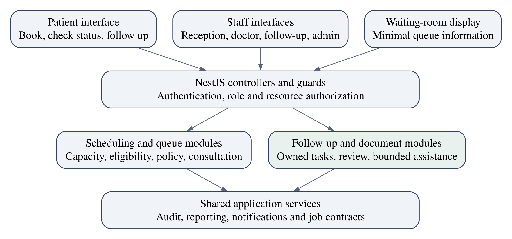

Figure 2. Logical architecture with interfaces, controllers and application modules

The interface layer contains patient, reception, doctor, follow-up and administration views. Controllers validate request shape and establish identity and authorization before application services execute business rules. NestJS modules provide explicit organization and dependency boundaries \[18\].

| **Module**               | **Owned responsibility**                                                         |
|--------------------------|----------------------------------------------------------------------------------|
| Identity and patients    | Account linkage, assisted patient identity and staff scope                       |
| Scheduling               | Sessions, capacity allocation and appointment lifecycle                          |
| Queue and consultation   | Eligibility, selection, doctor allocation, call/consultation transitions and ETA |
| Follow-up                | Task ownership, due status, disposition and linked returns                       |
| Documents and assistance | Private object references, OCR jobs, verification versions and bounded answers   |
| Shared support           | Audit, in-app notifications, operational reports and durable job contracts       |

**6.2 Technical Layer**

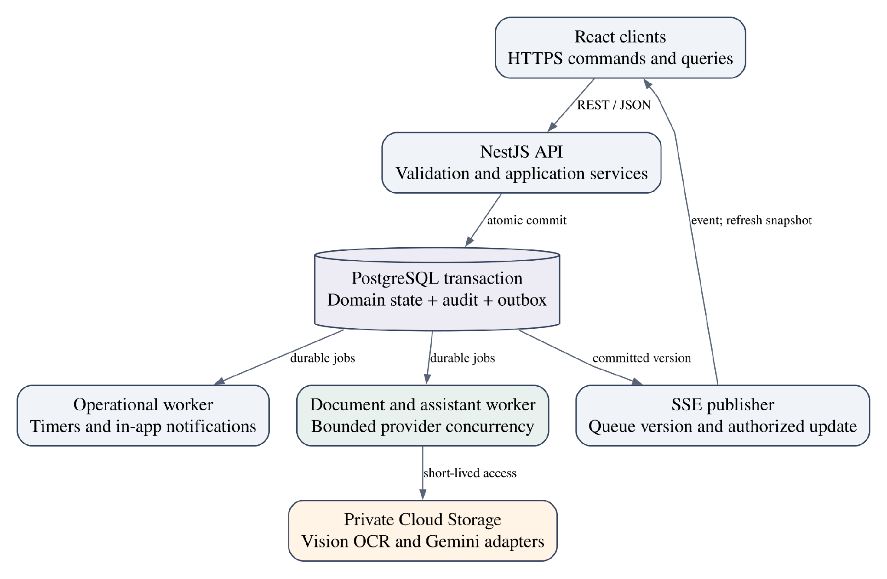

Figure 3. Technical architecture and committed-state event flow

The API performs short PostgreSQL transactions for operational commands. The same checked-out database client executes all statements within a transaction when using node-postgres \[19\]. A committed change includes its audit record and outbox/job intent. External OCR and model requests execute after commit in a worker, never while a booking or doctor lock is held. Concurrency-control literature provides the foundation for coordinating conflicting updates \[16\].

An operational worker handles timers and in-app notifications. A separate document/assistant worker uses bounded concurrency and resource limits. These processes share the codebase but isolate slow provider work from the request path. Durable delivery is at least once; handlers use stable job identifiers and state/version checks to avoid repeating committed effects. The design does not claim exactly-once external API execution.

NestJS supports SSE endpoints \[20\]. Queue events carry an authorized update or version notice. Reconnecting clients fetch an authoritative snapshot. An API instance can compare active session versions in a batch rather than issuing one database poll for every connected patient.

**Queue algorithm and policy parameters**

The queue is non-preemptive: a consultation already in progress continues. Scheduling runs when a doctor is free, no call is outstanding, and the session permits new calls. Clinical priority is assigned only by an authorized clinical actor. Follow-up escalation creates work for staff; it does not automatically grant clinical priority.

| **Parameter**            | **Approved initial value** | **Meaning**                                                                                                    |
|--------------------------|----------------------------|----------------------------------------------------------------------------------------------------------------|
| Normal rotation          | A, A, W                    | Two appointment selections to one walk-in selection when both normal groups remain eligible                    |
| Early eligibility        | 10 minutes                 | An appointment may enter the eligible set from scheduled time minus 10 minutes, after check-in                 |
| Late grace               | 15 minutes                 | Within grace retain appointment classification; after grace require staff capacity review and walk-in ordering |
| Aging trigger            | 45 minutes                 | Consider the oldest eligible waiting candidate after the threshold; no unconditional maximum-wait promise      |
| Called timeout           | 2 minutes                  | An unanswered call becomes skipped according to the controlled timeout transition                              |
| EWMA factor              | 0.2                        | Weight of latest completed consultation duration in the estimator                                              |
| Initial service estimate | 12 minutes                 | Configurable starting assumption until observed durations become available                                     |

Table 7. Versioned session policy

Appointment order is scheduled time, then check-in time, then stable entry sequence. Walk-in order is accepted check-in time, then stable sequence. Eligibility excludes absent, cancelled, called, in-service and completed entries. The earliest eligible time for an on-time appointment is the later of check-in and its permitted early-arrival window.

Policy changes are versioned and audited. The initial policy stays fixed for a session; any authorized correction must be recorded. A missed reservation may be released after the grace rule, but a late return does not retain guaranteed admission. Cancellation, release and arrival transitions use the same capacity contract.

**6.3 Queue selection flow**

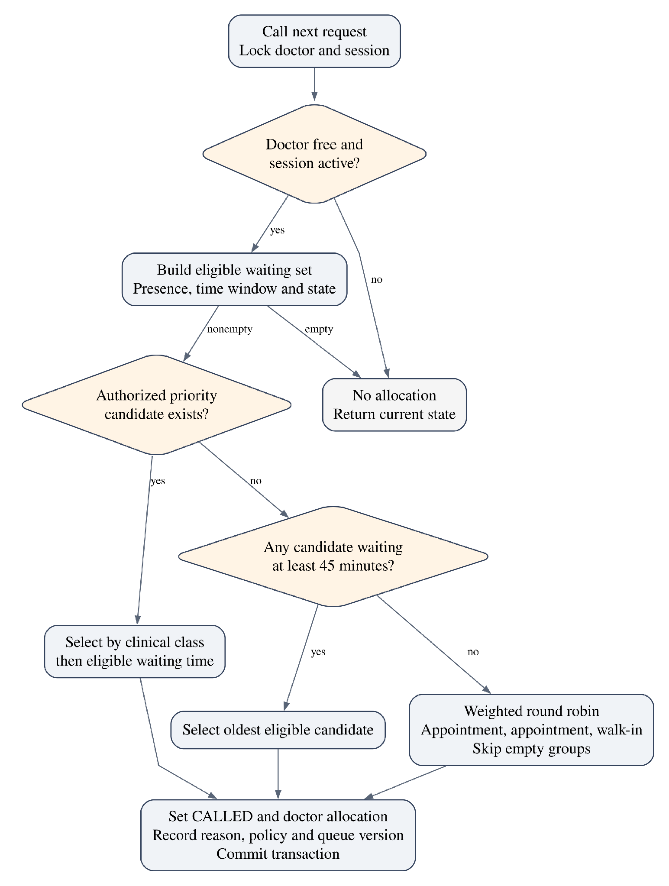

Figure 4. Deterministic selection under the doctor and session transaction guards

Priority candidates sort by authorized clinical class, then longest eligible waiting time and stable sequence. If no priority candidate exists, aging considers the oldest eligible waiting candidate. Otherwise the normal rotation selects from the appropriate group. Priority and aging overrides leave the normal rotation pointer unchanged.

**6.4 Selection procedure and worked example**

A scan over the eligible candidates is sufficient at the planned session size. Selecting the best candidate from each relevant set requires O(n) time and O(1) auxiliary selection state, excluding loaded rows and the audit snapshot. A heap would add update complexity because time, priority and eligibility change. Database filtering and indexing limit the scan to the active session.

Within one short transaction:

lock doctor, then session using the shared lock-order contract

reject or return current allocation if doctor is already occupied

E = present WAITING entries eligible at decision_time

if E is empty or session is paused: return NO_ALLOCATION

if authorized priority candidates exist:

candidate = best clinical class, oldest eligible wait, stable sequence

reason = CLINICAL_PRIORITY; preserve normal pointer

else if any eligible wait reaches aging threshold:

candidate = oldest eligible wait, stable sequence

reason = AGING; preserve normal pointer

else:

inspect A,A,W positions from the current pointer

skip empty groups without saving credits

candidate = first candidate in the selected group

advance pointer after the position actually served

set candidate CALLED and assign the doctor

write decision reason, policy version and queue version

commit domain state, audit and outbox intent together

| **Decision** | **Eligible condition**              | **Selection**              | **Normal pointer after** |
|--------------|-------------------------------------|----------------------------|--------------------------|
| 1            | A1, A2 and W1 eligible; no override | A1                         | Second A                 |
| 2            | P1 receives authorized priority     | P1                         | Second A, unchanged      |
| 3            | A2 and W1 remain eligible           | A2                         | W                        |
| 4            | W1 remains eligible                 | W1                         | First A                  |
| 5            | Only W2 eligible                    | W2 after empty A positions | First A                  |

Table 8. Illustrative selection trace, not a simulated performance result

The illustration assumes that the doctor becomes available between decisions and no candidate crosses the aging threshold. A continuous stream of clinical-priority cases or sustained overload can defeat a finite waiting-time guarantee. The system records and exposes that condition rather than promising that 45 minutes is a deadline.

**6.5 Transaction boundaries and concurrent requests**

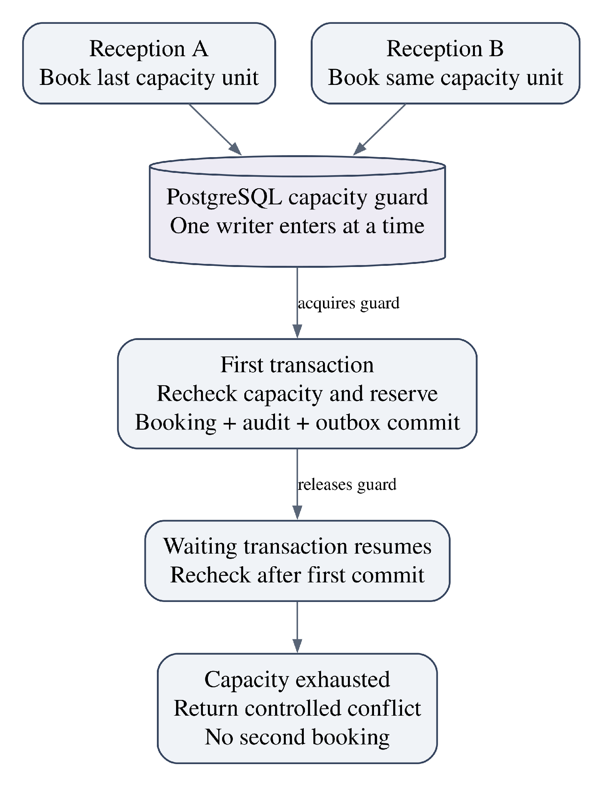

Figure 5. Competing bookings recheck capacity inside the transaction

Every operation that changes a protected resource follows the same guard contract. Booking locks the relevant capacity guard, rechecks available capacity, and writes allocation and appointment together. Rescheduling acquires the affected guards in a consistent order and releases the old reservation only if the new reservation succeeds. Completed consultations keep their allocation consumed.

For call-next, locking only the chosen queue row is insufficient: two transactions might choose two different rows. The design locks a doctor-level guard as well as the session, checks any outstanding call or consultation, and updates allocation atomically. This also covers a morning consultation that overruns into an afternoon session. All related state writers obey the same lock order. PostgreSQL provides the row-locking primitives for this design \[21\].

Idempotency records are scoped to actor and operation, with a request hash and stored outcome. Reusing a key with different input returns a conflict. A lost response after commit can therefore be retried without creating a second appointment. Deadlock/serialization retries are bounded and reuse the same idempotency identity. Locks last for the transaction, never for the consultation duration.

**6.6 Waiting-time estimation and exception handling**

Queue ordering and time prediction are separate components. The initial estimator uses an exponentially weighted moving average of completed consultation durations for the relevant doctor/session context: Geometric moving averages provide the statistical basis \[11\]; the smoothing factor and initial duration below are project parameters.

**m(t) = 0.2 × d(t) + 0.8 × m(t − 1), with initial m(0) = 12 minutes**

Here d(t) is the latest observed completed consultation duration. The estimate for a waiting patient combines residual work for the active consultation, projected durations of patients selected ahead under the same policy, and known breaks or pauses. The projection must advance simulated time so future eligibility and aging can change the predicted order. New arrivals and future clinical-priority changes remain uncertain.

During the cold start, max(0, m − elapsed consultation time) is only a provisional residual estimate. Once a consultation exceeds that mean, a zero residual does not imply immediate availability. The interface should widen or withhold an estimate when the residual is unsupported. Calibration later compares predicted and actual start times and derives empirical uncertainty ranges; no unmeasured confidence percentage is claimed.

| **Condition**            | **System response**                                                                                      |
|--------------------------|----------------------------------------------------------------------------------------------------------|
| Late arrival after grace | Staff rechecks capacity; admitted patient follows walk-in ordering.                                      |
| Called patient absent    | After the two-minute rule, transition to SKIPPED and release the outstanding doctor call.                |
| Skipped patient returns  | Reactivate the same entry with a new eligible time; preserve previous call history and apply late rules. |
| Doctor paused            | Stop new calls; include a known pause or withhold ETA if its duration is unknown.                        |
| Doctor unavailable       | Reception arranges alternatives with the patient. Do not silently change the selected doctor.            |
| Display disconnected     | Show stale/reconnecting state and refresh an authorized snapshot after reconnect.                        |
| Demand exceeds capacity  | Expose workload pressure and require operational action; do not conceal overload through optimistic ETA. |

**6.7 API contracts and domain events**

| **Operation**           | **Example route**                    | **Atomic responsibility**                                 |
|-------------------------|--------------------------------------|-----------------------------------------------------------|
| Book                    | POST /appointments                   | Capacity allocation, appointment, audit and outbox        |
| Reschedule              | POST /appointments/{id}/reschedule   | Reserve new capacity and release old reservation together |
| Check in                | POST /appointments/{id}/check-in     | One visit and queue entry                                 |
| Admit walk-in           | POST /sessions/{id}/walk-ins         | Capacity check and admission records                      |
| Call next               | POST /sessions/{id}/call-next        | Doctor guard, policy selection and allocation             |
| Consultation action     | POST /visits/{id}/start or /complete | Validated transition; release doctor on completion        |
| Follow-up task          | POST /follow-up-tasks                | Owner, due time, source visit and task status             |
| Queue snapshot / stream | GET /sessions/{id}/queue or /events  | Role-scoped snapshot and committed version updates        |

Table 10. Representative API contracts

The final endpoint schema belongs to implementation detail; these contracts specify the approved responsibilities. Commands validate entity version/state and return controlled conflicts for stale actions. SSE authentication uses an authorized session or supported authenticated streaming client rather than exposing credentials in public URLs.

| **Domain event**                            | **Producer and intended consumer**                                  |
|---------------------------------------------|---------------------------------------------------------------------|
| AppointmentBooked / AppointmentRescheduled  | Scheduling; operational notifications and audit-linked reporting    |
| AppointmentCancelled / ReservationReleased  | Scheduling or timer; capacity visibility                            |
| VisitCheckedIn                              | Arrival service; queue snapshot publication                         |
| QueuePatientCalled / QueuePatientSkipped    | Queue service or timer; staff and patient views                     |
| ConsultationStarted / ConsultationCompleted | Consultation service; occupancy, estimator and follow-up initiation |
| DocumentUploaded / DocumentOCRCompleted     | Documents/worker; processing and clinical-review inbox              |
| InstructionVerified                         | Authorized review; approved context availability                    |
| FollowUpOpened / FollowUpResolved           | Follow-up service; owned inbox and outcome reporting                |
| ReturnAppointmentBooked                     | Scheduling; originating task linkage                                |

Events carry event ID, entity ID/version, timestamp and minimal routing data. Clinical text remains in authorized storage. A worker records attempts and terminal failure state so unsuccessful work is visible rather than silently discarded.

**6.8 MediBridge-inspired follow-up processing**

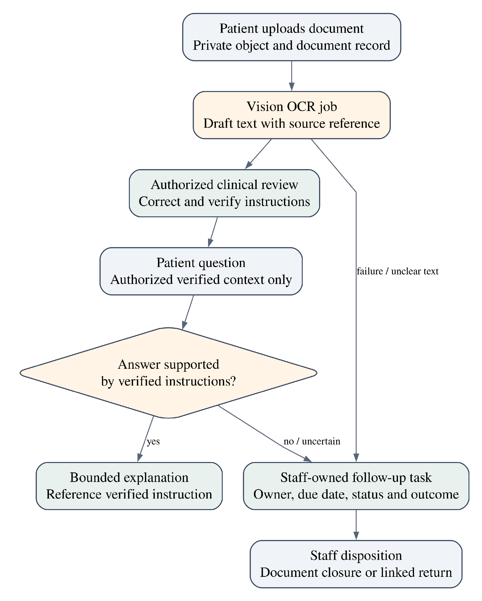

Figure 6. OCR drafts, clinical verification and accountable follow-up

A private upload receives a document record and content hash. Validation checks file type, size and page count before processing. OCR extracts text and source location without making it an approved instruction. A clinical reviewer corrects the extraction and records the verifier, time and immutable instruction version. Revisions supersede earlier context while preserving history. Smith’s OCR engine overview supplies technical background \[12\], without establishing Vision’s internal method or prescription accuracy.

The assistant receives only the current patient’s authorized verified context. Its answer references the supporting instruction version. Uploaded text is data, not authority to change application behavior. Requests for diagnosis, changed treatment, unsupported advice or missing context create an owned staff task. This guard does not establish clinical safety; real-world use would require additional clinical and institutional validation. Research on hallucination \[13\] and retrieval-grounded generation \[14\] informs the source and review controls; it does not establish the clinical validity of this implementation.

**6.9 Data Layer**

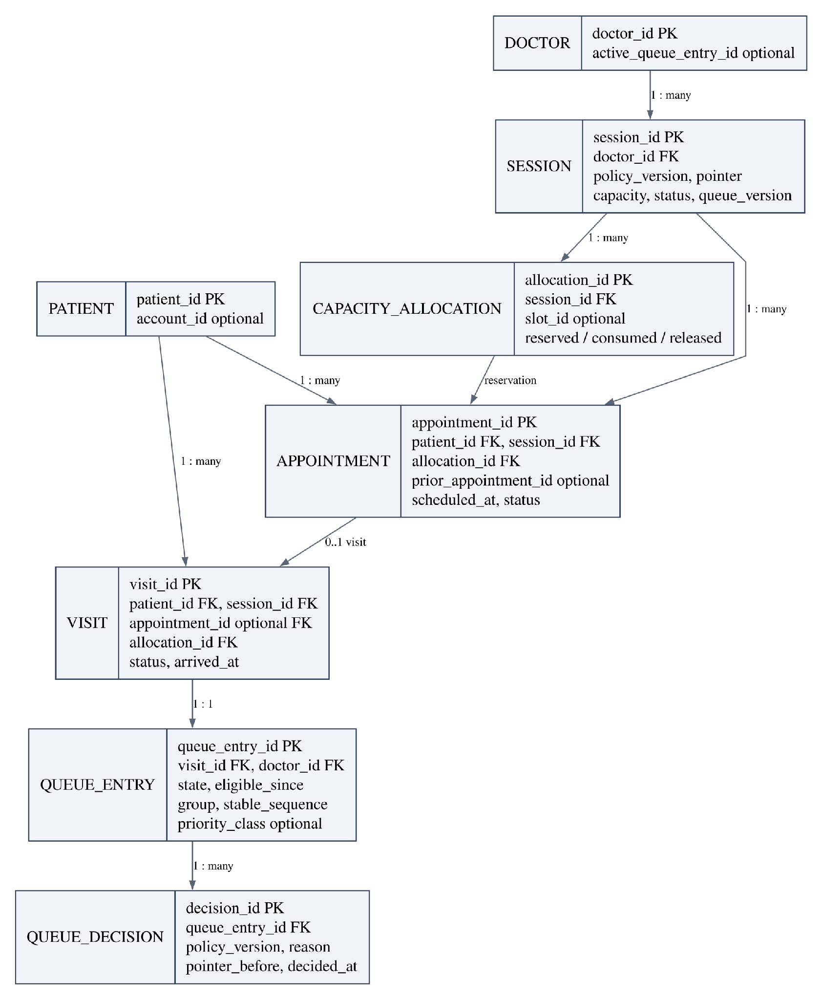

Figure 7. Core relational model with separate reservation, visit and queue records

The data model separates stable patient identity from login identity. Each appointment targets a doctor/session and a capacity allocation. An attended booked visit links to that appointment; a walk-in visit can exist without one. Each admitted consultation visit has one reusable queue entry. Queue decisions record policy and reason separately from the current entry state.

The diagram presents central relationships, not every operational column. Appointment-to-visit linkage permits at most one attended visit for that appointment. Return attendance requires a new linked appointment and visit. Capacity allocation transitions distinguish reserved, consumed and released places.

**6.10 Follow-up relationships and supporting persistence**

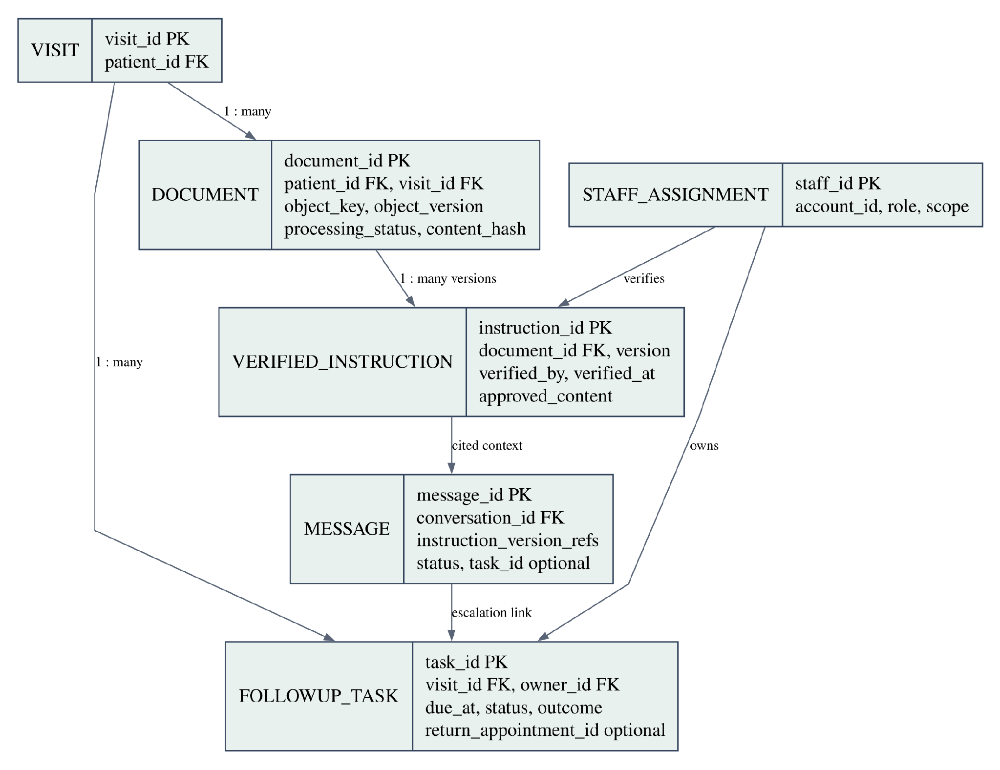

Figure 8. Follow-up ownership, document verification and message provenance

| **Supporting record group**    | **Key persisted information**                                                                |
|--------------------------------|----------------------------------------------------------------------------------------------|
| Accounts and staff assignments | Identity-provider subject, role, hospital scope and doctor/team assignment                   |
| Conversations and messages     | Patient ownership, source instruction versions, request outcome and optional escalation task |
| Jobs and outbox events         | Stable ID, type, entity/version, state, attempts, lease expiry and next retry                |
| Idempotency records            | Actor/operation/key uniqueness, input hash and committed response                            |
| Audit events                   | Actor, timestamp, operation, entity, previous/new state or material change and reason        |
| Notifications                  | Recipient, originating event and delivery/read state for in-app notices                      |

Table 12. Supporting data responsibilities

Cloud Storage holds document bytes; PostgreSQL holds the authorized object reference and version. A database transaction cannot atomically roll back a cloud upload. Processing therefore uses explicit uploaded/accepted states and a reconciler for abandoned objects or missing job intent. Recovery checks database references against retained object versions.

**6.11 Lifecycle boundaries and database constraints**

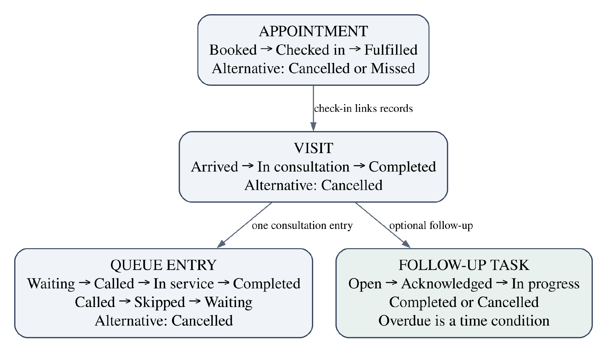

Figure 9. Separate lifecycles connected by explicit domain operations

| **Invariant or access path**          | **Proposed enforcement**                                                                      |
|---------------------------------------|-----------------------------------------------------------------------------------------------|
| One queue entry for an admitted visit | Unique visit_id on queue_entries; re-entry changes state rather than inserting a duplicate    |
| One attendance per appointment        | Unique non-null appointment_id on visits                                                      |
| One active doctor allocation          | Doctor guard plus a partial unique constraint/index over active called/in-service allocations |
| Capacity never oversubscribed         | Shared capacity guard, state checks and allocation mutation in one transaction                |
| Queue candidate lookup                | Index session_id, state, eligibility time; group/order fields evaluated under the policy      |
| Staff work due                        | Index owner_id, status, due_at; overdue derived from time and unresolved state                |
| Repeated request protection           | Unique actor, operation and idempotency key, with request hash                                |
| Document/message ownership            | Foreign keys and server-side ownership checks on every access path                            |

Table 13. Data integrity and index plan

Foreign keys preserve relationships and unique constraints protect identity assumptions \[22\]. Cross-record capacity totals require the transactional guard; a row-level CHECK constraint alone cannot enforce that aggregate. Database constraints complement the application’s state machine. All time instants use timezone-aware storage; the UI renders hospital-local time.

**6.12 Infrastructure Layer**

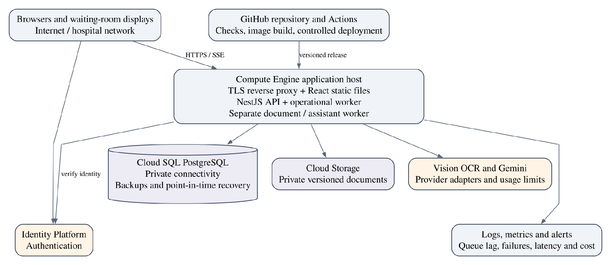

Figure 10. Proposed Google Cloud hosted reference deployment

The cloud reference uses Compute Engine for the API, reverse proxy and separate worker containers; Cloud SQL for PostgreSQL; private Cloud Storage for documents; Identity Platform for authentication; and Vision/Gemini adapters for the add-on. The preferred location for application and database resources is Mumbai, subject to service availability. OCR/model processing locations must be verified separately; placing the database in India does not establish that all provider processing remains there \[23\]–\[26\].

Initial test sizing carries forward the approved planning envelope: approximately 4 vCPU/8 GB for the application host and 2 vCPU/4 GB with 20 GB initial storage for the managed database, mapped to available Google Cloud machine configurations. These are starting specifications for measurement, not verified throughput capacity. A single application host is a failure point; container separation is not host redundancy.

**6.13 Delivery pipeline and repository organization**

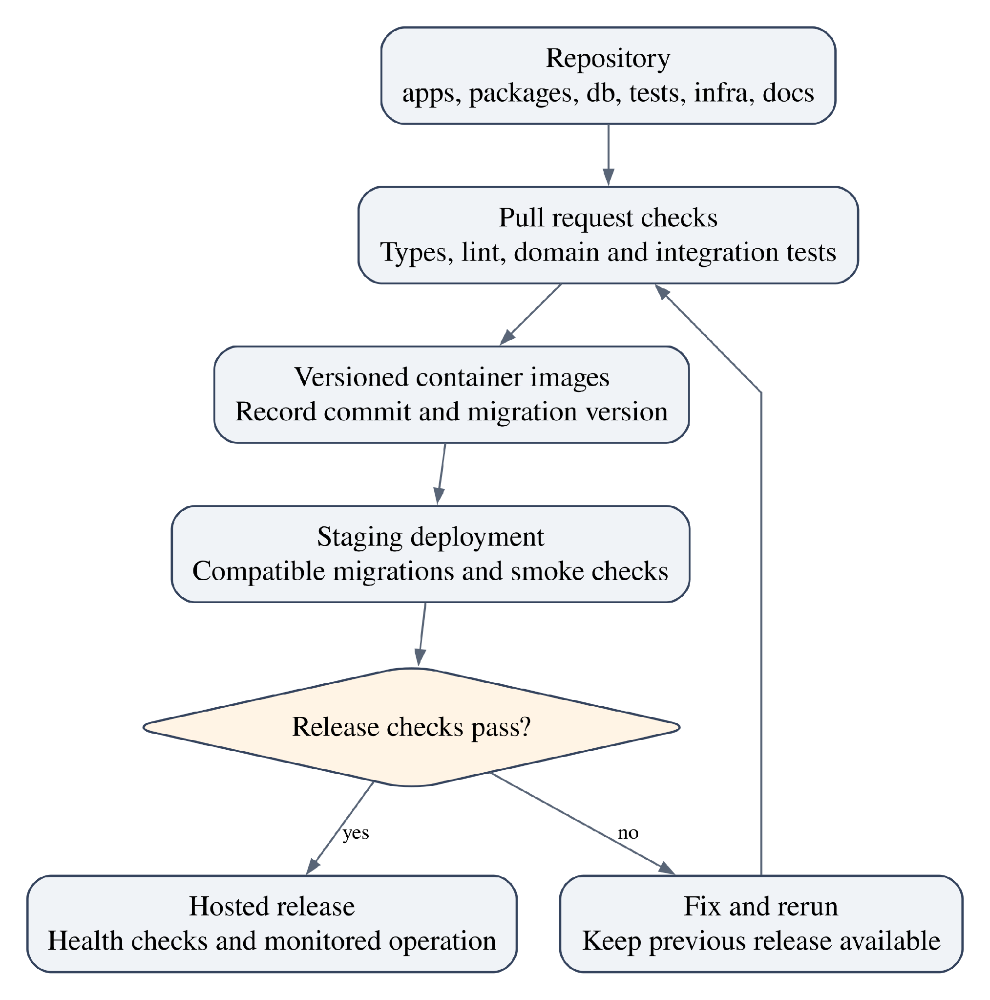

Figure 11. Versioned build and deployment flow

| **Repository path** | **Responsibility**                                          |
|---------------------|-------------------------------------------------------------|
| apps/web            | React interfaces and client tests                           |
| apps/api            | NestJS controllers, authorization and application services  |
| apps/worker         | Operational jobs and document/assistant worker entry points |
| packages/domain     | Pure queue policy, state rules and shared domain types      |
| packages/contracts  | Validated request/event contracts                           |
| db/migrations       | Versioned schema and controlled seed data                   |
| tests               | Concurrency, integration, simulation and workload scenarios |
| infra and docs      | Container/deployment configuration, diagrams and runbooks   |

Table 14. Repository boundaries

GitHub Actions checks types, linting and relevant tests, builds versioned images, and deploys a release with a recorded migration version. Schema changes use compatibility windows where possible. Rolling back application code does not automatically roll back database changes. Secrets are supplied through protected runtime configuration rather than committed source files. The proposed checks follow the general build, test and delivery practices surveyed by Shahin et al. \[17\].

**6.14 Recovery and observability**

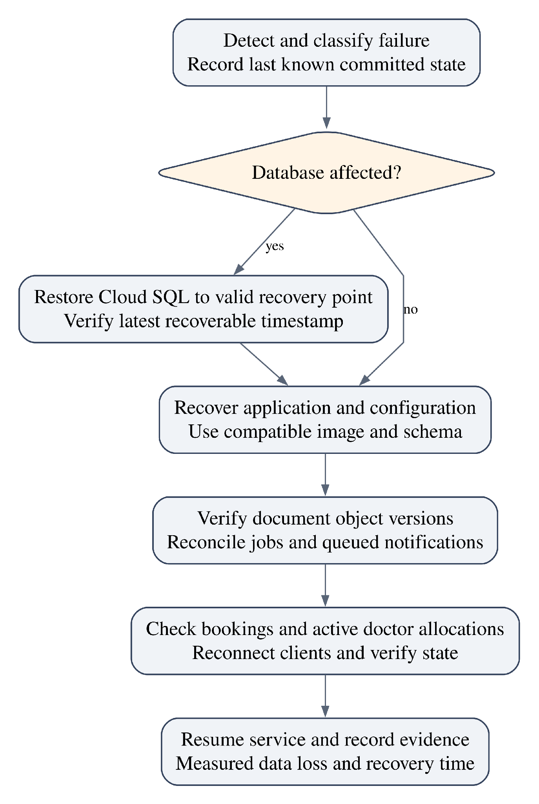

Figure 12. Recovery procedure and evidence needed for RPO and RTO

Point-in-time recovery requires configured backups and transaction-log retention. Cloud SQL exposes the recoverable time window \[27\]. A daily backup alone cannot establish a 15-minute recovery point objective. The recovery exercise measures both the latest recoverable committed data and elapsed time until staff can safely resume operations.

Observe request latency, controlled conflicts, unexpected errors, database pool/lock waits, active doctor allocations, queue freshness, job age/retries and provider expenditure. Logs use correlation IDs and avoid unnecessary clinical text. Recovery reconciles pending jobs and refreshes client snapshots before staff resume calls. Neither the single-host design nor a successful short load test demonstrates monthly availability.

**7. TECH STACK SELECTION JUSTIFICATION**

**7.1 Architectural selection and trade-offs**

| **Decision**       | **Selected approach**           | **Reason and accepted trade-off**                                                                         |
|--------------------|---------------------------------|-----------------------------------------------------------------------------------------------------------|
| Deployment pattern | Modular monolith                | Keeps critical transactions local and deployment manageable; modules share a release boundary.            |
| Frontend           | React + TypeScript + Vite       | Fits authenticated interactive workflows; server rendering is not required for the main interfaces.       |
| Backend            | NestJS + TypeScript             | Explicit modules and guards; framework conventions add structure and some overhead.                       |
| Persistence        | PostgreSQL + node-postgres      | Relational integrity and explicit SQL transactions; team owns migrations and query discipline.            |
| Live updates       | SSE + snapshot recovery         | Matches server-to-client queue updates; persistent connections and reconnection need monitoring.          |
| Background work    | PostgreSQL jobs/outbox          | Reuses durable persistence at modest volume; polling, leases and idempotence need careful implementation. |
| Documents          | Private Cloud Storage           | Separates document bytes from transactional records; upload and database consistency need reconciliation. |
| Cloud              | Google Cloud reference          | User preference and suitable managed services; exact cost depends on configuration and duty cycle.        |
| OCR                | Vision Document Text Detection  | Economical page-based OCR candidate; handwriting quality and review effort must be measured.              |
| Assistant          | Gemini 2.5 Flash-Lite candidate | Low published token cost for bounded assistance; model quality and lifecycle require checking.            |

Table 15. Technology decisions and limitations

Microservices, Kafka and a separate Redis queue are not required by the approved scale. Introducing them now would add operational dependencies without removing the need for transactional correctness. They remain possible later responses to measured bottlenecks, rather than baseline project requirements.

**7.2 Feasibility and operating-cost model**

Local Docker execution is the default economical development and college-demo environment. The hosted design is a separately costed reference for load/recovery evaluation. Provider credits, free allowances and university benefits are not assumed to cover infrastructure.

| **Cost component**       | **Budget calculation / treatment**                                                                                       |
|--------------------------|--------------------------------------------------------------------------------------------------------------------------|
| Application compute      | Selected VM hourly rate × provisioned hours, plus attached disk and applicable network costs                             |
| Managed database         | Selected Cloud SQL compute/memory rate × provisioned hours, plus storage, backups and retained recovery logs             |
| Documents                | Stored GB-months, versions, operations and network transfer; 6 GB/month is new original data, not total retained storage |
| Identity and diagnostics | Authentication method/usage, retained logs and monitoring usage; no SMS delivery included                                |
| OCR                      | Pages processed × applicable tier rate, including repeat processing where billable                                       |
| Assistant                | Input/output token totals × model rates, plus retries or separately enabled services                                     |

Table 16. Hosted cost worksheet

An all-inclusive monthly hosting figure is not asserted because a region-specific machine quote, retention duration, duty cycle and billing-account allowances have not been finalized. The report therefore provides a reproducible cost model and verified API examples. This is a cost uncertainty, not a claim that managed hosting is free.

Vision currently lists the first 1,000 monthly OCR units as free and the next tier at \$1.50 per 1,000. A PDF page is one image unit. At 3,000 documents per planning month, one page/document gives \$3.00, three pages gives \$12.00, and ten pages gives \$43.50 in OCR charges, assuming the free allowance is available and one processing pass \[28\]. Basic Document AI OCR has comparable listed pricing; its name alone does not imply a higher base OCR price \[29\].

Gemini 2.5 Flash-Lite currently lists \$0.10 per million text input tokens and \$0.40 per million output tokens. At 18,000 requests, an illustrative 2,000 input and 400 output tokens/request yield 36 million input and 7.2 million output tokens: \$3.60 + \$2.88 = \$6.48. These token lengths are budgeting assumptions. Prices exclude tax and unrelated services and require rechecking before deployment \[30\], \[31\].

**7.3 Implementation sequence and effort**

The team is assumed to have medium-to-high development experience. Effort estimates below are engineering planning judgments, not historical productivity measurements. Each milestone includes its relevant interface, backend behavior and tests; integrated verification consolidates evidence rather than postponing all testing.

| **Milestone** | **Deliverable**                                              | **Person-hours** |
|---------------|--------------------------------------------------------------|------------------|
| M1            | Foundation, identity, roles, migrations and CI               | 24–32            |
| M2            | Appointment capacity, booking, reschedule and arrival        | 28–40            |
| M3            | Queue policy, doctor allocation and consultation transitions | 40–56            |
| M4            | Operational views, SSE and qualified ETA                     | 24–36            |
| M5            | Owned follow-up and linked return booking                    | 20–28            |
| M6            | Private documents, OCR review and bounded assistant          | 32–48            |
| M7            | Concurrency, workload, simulation and recovery evidence      | 40–56            |
| M8            | Deployment instructions and demonstration handover           | 16–24            |

Table 17. Phase 2 implementation effort

Total base effort is 224–320 person-hours. A 20% contingency yields approximately 269–384 person-hours. Four people contributing 12 hours/week each would require approximately 6–8 weeks; at 20 hours/week each, approximately 4–5 weeks. Dependencies and availability affect elapsed time. The Phase 2 calendar deadline has not been specified.

| **Team member and USN**   | **Proposed ownership**                                        |
|---------------------------|---------------------------------------------------------------|
| Rohan Balu — 1BY23IS177   | Queue policy, domain rules and architectural integration      |
| Rishab Paul — 1BY23IS175  | Role-specific interfaces, live updates and workflow usability |
| Rahul Sonar — 1BY23IS170  | Schema, appointment APIs and transactional integrity          |
| Rohan Bharat — 1BY23IS178 | OCR/assistant integration, workers, deployment and recovery   |

Table 18. Proposed implementation responsibilities

All members review requirements and understand the queue and follow-up boundaries. A second member reviews changes to transaction guards and queue ordering. Appointment/visit integrity precedes queue verification; instruction verification and task ownership precede assistant integration.

**7.4 Evaluation limitations and risk treatment**

| **Risk**                                 | **Planned response**                                                        | **Remaining limitation**                                    |
|------------------------------------------|-----------------------------------------------------------------------------|-------------------------------------------------------------|
| Doctor demand exceeds capacity           | Per-session admission checks, overload visibility and sensitivity scenarios | Queue policy cannot create clinical capacity                |
| Queue starvation or perceived unfairness | Aging, reason codes and group-specific waiting-time evaluation              | Priority surges can still produce long waits                |
| Concurrent operational commands          | Shared guard order, database constraints and idempotency                    | Correctness depends on every writer following the contract  |
| OCR or assistant error                   | Clinical verification, authorized context, staff fallback and failure tests | Academic evaluation is not clinical validation              |
| Single application host fails            | Restart/redeploy runbook and measured recovery exercise                     | Initial hosted reference has no application-host redundancy |
| Recovery loses object consistency        | Retain object versions and reconcile references/jobs                        | RPO/RTO remain unverified until full recovery tests         |
| Cost or provider change                  | Usage limits, bounded retries, provider adapters and pricing review         | Actual total spend depends on deployment and usage          |
| Scope expansion                          | Keep outpatient consultation and follow-up boundaries explicit              | Insurance, inpatient and other ERP functions stay excluded  |

Table 19. Risk, response and residual limitation

Phase 1 delivers this proposal, requirements, architectural blueprints, technology justification and evaluation plan. Phase 2 implements and measures the system. No measured throughput, OCR accuracy, clinical effectiveness, hospital adoption, legal compliance certification or production readiness is claimed. Any future deployment with real patient information requires the hospital’s clinical, privacy and operational review.

The main engineering contribution to evaluate is whether explicit lifecycles, atomic operational changes, explainable queue rules and owned follow-up can function coherently at the declared workload. The report, presentation and demonstration must retain the same definitions and must distinguish planned targets from measured outcomes.

8.  **EVALUATION RUBRICS**

<table>
<colgroup>
<col style="width: 8%" />
<col style="width: 13%" />
<col style="width: 16%" />
<col style="width: 16%" />
<col style="width: 16%" />
<col style="width: 11%" />
<col style="width: 18%" />
</colgroup>
<tbody>
<tr class="odd">
<td><strong>S.No</strong></td>
<td><strong>Evaluation Criteria</strong></td>
<td><strong>Excellent</strong></td>
<td><strong>Good</strong></td>
<td><strong>Needs Improvement</strong></td>
<td><strong>Max Marks</strong></td>
<td><strong>Marks Obtained</strong></td>
</tr>
<tr class="even">
<td>1.</td>
<td>Problem &amp; SRS</td>
<td>
Defines the problem statement completely using a standard structure (Problem 🡪 Root Cause 🡪Impact 🡪Target Outcome),

Complete SRS (&gt;=8 Functional Requirements, &gt;=4 Non FRs)

<strong>(9-10 marks)</strong>
</td>
<td>
Defines the problem statement but lacks the standard structure.

SRS

(5-7 FRs,

2-3 NFRs)

<strong>(6-8 marks)</strong>
</td>
<td>
Vague problem statement;

incomplete SRS (&lt;5 FRs, NFRs)

<strong>(0-5 marks)</strong>
</td>
<td>10</td>
<td></td>
</tr>
<tr class="odd">
<td>2.</td>
<td>Multi-Tier Diagrams</td>
<td>
Complete diagrams for Logical, Technical, Data, and Infrastructure layers.

<strong>(13-15 marks)</strong>
</td>
<td>
Lacks diagrams, but minor overlap or missing detail in one layer.

<strong>(9-12 marks)</strong>
</td>
<td>
Incomplete diagrams; missing major architectural layers.

<strong>(0-8 marks)</strong>
</td>
<td>15</td>
<td></td>
</tr>
<tr class="even">
<td>3.</td>
<td>Tech Stack Choice</td>
<td>
Strong justification for architecture patterns and chosen tech stack.

<strong>(9-10 marks)</strong>
</td>
<td>
Fair reasoning for tech stack and architecture choices.

<strong>(6-8 marks)</strong>
</td>
<td>
Weak or no justification for technical decisions.

<strong>(0-5 marks)</strong>
</td>
<td>10</td>
<td></td>
</tr>
<tr class="odd">
<td>4.</td>
<td>Presentation &amp; Q&amp;A</td>
<td>
Professional slides, good team coordination, clear answers to Q&amp;A.

<strong>(4-5 marks)</strong>
</td>
<td>
Clean slides, good presentation, answered most Q&amp;A.

<strong>(3 marks)</strong>
</td>
<td>
Unorganized slides, poor time management, unable to answer Q&amp;A.

<strong>(0-2 marks)</strong>
</td>
<td>5</td>
<td></td>
</tr>
<tr class="even">
<td colspan="6"><strong>TOTAL MARKS</strong></td>
<td></td>
</tr>
</tbody>
</table>

> Signature of Course Co-Ordinator

9.  **REFERENCES/BIBLIOGRAPHY**

**Research papers**

\[1\] T. Cayirli and E. Veral, “Outpatient scheduling in health care: A review of literature,” Production and Operations Management, vol. 12, no. 4, pp. 519–549, 2003. https://doi.org/10.1111/j.1937-5956.2003.tb00218.x

\[2\] D. Gupta and B. Denton, “Appointment scheduling in health care: Challenges and opportunities,” IIE Transactions, vol. 40, no. 9, pp. 800–819, 2008. https://doi.org/10.1080/07408170802165880

\[3\] A. Ahmadi-Javid, Z. Jalali, and K. J. Klassen, “Outpatient appointment systems in healthcare: A review of optimization studies,” European Journal of Operational Research, vol. 258, no. 1, pp. 3–34, 2017. https://doi.org/10.1016/j.ejor.2016.06.064

\[4\] G. C. Kaandorp and G. Koole, “Optimal outpatient appointment scheduling,” Health Care Management Science, vol. 10, no. 3, pp. 217–229, 2007. https://doi.org/10.1007/s10729-007-9015-x

\[5\] T. Cayirli, K. K. Yang, and S. A. Quek, “A Universal Appointment Rule in the Presence of No‐Shows and Walk‐Ins,” Production and Operations Management, vol. 21, no. 4, pp. 682–697, 2012. https://doi.org/10.1111/j.1937-5956.2011.01297.x

\[6\] L. R. LaGanga and S. R. Lawrence, “Appointment Overbooking in Health Care Clinics to Improve Patient Service and Clinic Performance,” Production and Operations Management, vol. 21, no. 5, pp. 874–888, 2012. https://doi.org/10.1111/j.1937-5956.2011.01308.x

\[7\] L. F. Dantas, J. L. Fleck, F. L. Cyrino Oliveira, and S. Hamacher, “No-shows in appointment scheduling – a systematic literature review,” Health Policy, vol. 122, no. 4, pp. 412–421, 2018. https://doi.org/10.1016/j.healthpol.2018.02.002

\[8\] J. Luo, V. G. Kulkarni, and S. Ziya, “Appointment Scheduling Under Patient No-Shows and Service Interruptions,” Manufacturing & Service Operations Management, vol. 14, no. 4, pp. 670–684, 2012. https://doi.org/10.1287/msom.1120.0394

\[9\] J. D. C. Little, “A Proof for the Queuing Formula: L = λW,” Operations Research, vol. 9, no. 3, pp. 383–387, 1961. https://doi.org/10.1287/opre.9.3.383

\[10\] J. F. C. Kingman, “The single server queue in heavy traffic,” Mathematical Proceedings of the Cambridge Philosophical Society, vol. 57, no. 4, pp. 902–904, 1961. https://doi.org/10.1017/s0305004100036094

\[11\] S. W. Roberts, “Control Chart Tests Based on Geometric Moving Averages,” Technometrics, vol. 1, no. 3, pp. 239–250, 1959. https://doi.org/10.1080/00401706.1959.10489860

\[12\] R. Smith, “An Overview of the Tesseract OCR Engine,” Ninth International Conference on Document Analysis and Recognition (ICDAR 2007) Vol 2, pp. 629–633, 2007. https://doi.org/10.1109/icdar.2007.4376991

\[13\] Z. Ji et al., “Survey of Hallucination in Natural Language Generation,” ACM Computing Surveys, vol. 55, no. 12, pp. 1–38, 2023. https://doi.org/10.1145/3571730

\[14\] P. Lewis et al., “Retrieval-Augmented Generation for Knowledge-Intensive NLP Tasks,” Advances in Neural Information Processing Systems, vol. 33, 2020. https://proceedings.neurips.cc/paper/2020/hash/6b493230205f780e1bc26945df7481e5-Abstract.html

\[15\] J. L. Callen, J. I. Westbrook, A. Georgiou, and J. Li, “Failure to Follow-Up Test Results for Ambulatory Patients: A Systematic Review,” Journal of General Internal Medicine, vol. 27, no. 10, pp. 1334–1348, 2012. https://doi.org/10.1007/s11606-011-1949-5

\[16\] P. A. Bernstein and N. Goodman, “Concurrency Control in Distributed Database Systems,” ACM Computing Surveys, vol. 13, no. 2, pp. 185–221, 1981. https://doi.org/10.1145/356842.356846

\[17\] M. Shahin, M. A. Babar, and L. Zhu, “Continuous Integration, Delivery and Deployment: A Systematic Review on Approaches, Tools, Challenges and Practices,” IEEE Access, vol. 5, pp. 3909–3943, 2017. https://doi.org/10.1109/access.2017.2685629

**Technical documentation**

\[18\] NestJS, “Modules.” \[Online\]. Available: https://docs.nestjs.com/modules Accessed: Sep. 10, 2026.

\[19\] node-postgres, “Transactions.” \[Online\]. Available: https://node-postgres.com/features/transactions Accessed: Sep. 10, 2026.

\[20\] NestJS, “Server-Sent Events.” \[Online\]. Available: https://docs.nestjs.com/techniques/server-sent-events Accessed: Sep. 10, 2026.

\[21\] PostgreSQL Global Development Group, “Explicit Locking.” \[Online\]. Available: https://www.postgresql.org/docs/current/explicit-locking.html Accessed: Sep. 10, 2026.

\[22\] PostgreSQL Global Development Group, “Constraints.” \[Online\]. Available: https://www.postgresql.org/docs/current/ddl-constraints.html Accessed: Sep. 10, 2026.

\[23\] Google Cloud, “Compute Engine documentation.” \[Online\]. Available: https://cloud.google.com/compute/docs Accessed: Sep. 10, 2026.

\[24\] Google Cloud, “Cloud SQL for PostgreSQL documentation.” \[Online\]. Available: https://cloud.google.com/sql/docs/postgres Accessed: Sep. 10, 2026.

\[25\] Google Cloud, “Cloud Storage documentation.” \[Online\]. Available: https://cloud.google.com/storage/docs Accessed: Sep. 10, 2026.

\[26\] Google Cloud, “Identity Platform documentation.” \[Online\]. Available: https://cloud.google.com/identity-platform/docs Accessed: Sep. 10, 2026.

\[27\] Google Cloud, “Perform point-in-time recovery.” \[Online\]. Available: https://docs.cloud.google.com/sql/docs/postgres/backup-recovery/pitr Accessed: Sep. 10, 2026.

\[28\] Google Cloud, “Cloud Vision pricing.” \[Online\]. Available: https://cloud.google.com/vision/pricing Accessed: Sep. 10, 2026.

\[29\] Google Cloud, “Document AI pricing.” \[Online\]. Available: https://cloud.google.com/products/document-ai/pricing Accessed: Sep. 10, 2026.

\[30\] Google AI for Developers, “Gemini Developer API pricing.” \[Online\]. Available: https://ai.google.dev/gemini-api/docs/pricing Accessed: Sep. 10, 2026.

\[31\] Google AI for Developers, “Gemini deprecations.” \[Online\]. Available: https://ai.google.dev/gemini-api/docs/deprecations Accessed: Sep. 10, 2026.

**Course materials**

\[32\] BMS Institute of Technology & Management, “VII Semester Revised Scheme & Syllabus,” BCS703B Building Enterprise Applications, and “BEA Mini_Project Phase1 Report - ISE,” course materials supplied by the team, 2026–2027.
